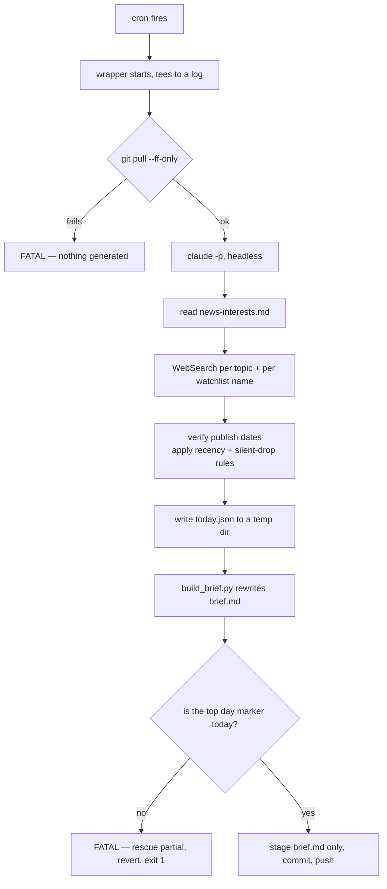

# daily-news-brief

A headless [Claude Code](https://claude.com/claude-code) skill that writes you a news brief every
morning and commits it to a markdown file in this repo, newest day at the top.

It is built around one idea: **a language model is trusted to pick stories, and trusted with
nothing else.** It does not touch git, it does not assemble the file, and it is not believed when
it reports its own success. Those jobs belong to a shell wrapper and a Python builder that fail
loudly instead.

Use this repo as a template, add your interests, add one crontab line.

---

## Quick start

1. **Use this template** (green button, or `gh repo create my-brief --template <this-repo>`) and
   clone your copy. Keep it **private** — the archive it produces is a record of what you read.
2. **Write your interests.** Copy the example and edit it:

   ```bash
   cp .claude/skills/daily-news-summary/news-interests.example.md news-interests.md
   ```

   Topics, section order, how many stories each gets, anyone you want tracked by name, outlets to
   avoid. This is the only file you need to write.
3. **Try it by hand** before trusting it to cron:

   ```bash
   ./scripts/morning-brief.sh
   ```

   It pulls, runs Claude, verifies the result, then commits and pushes `brief.md`.
4. **Schedule it.** `crontab -e`:

   ```
   PATH=/home/you/.local/bin:/usr/local/bin:/usr/bin:/bin
   0 8 * * * BRIEF_REPO=/home/you/my-brief /home/you/my-brief/scripts/morning-brief.sh
   ```

   The `PATH` line matters — `claude` usually lives in `~/.local/bin`, which is not on cron's
   default path. `BRIEF_REPO` is optional (the wrapper defaults to the repo it lives in) but
   explicit is better in a crontab.

Requirements: `claude`, `python3`, `git`, and a `git push` that works non-interactively from cron
(a credential helper backed by your keyring, e.g. `gh auth git-credential`).

---

## The pieces

| Path | Role |
| --- | --- |
| `brief.md` | The archive. Newest day at top, 90 days retained. Generated — never hand-edit it. |
| `news-interests.md` | **Yours to write.** Topics, section order, story counts, watchlist, source preferences. |
| `.claude/skills/daily-news-summary/SKILL.md` | How a brief is made: research method, recency rules, output format. Generic. |
| `.claude/skills/daily-news-summary/news-interests.example.md` | Template for the file above. |
| `.claude/skills/daily-news-summary/build_brief.py` | Assembles markdown from a JSON entry + the previous archive. |
| `scripts/morning-brief.sh` | Cron wrapper: pull → run Claude → verify → commit → push. |

Five components, each with one job:

**Interests** decide *what* to cover. **The skill** decides *how* — search per topic, verify the
real publish date, drop stale and duplicate stories, format the result. **The builder** owns
structure: it validates one day's entry, renders the markdown, merges it with the previous
archive, and enforces retention. **The wrapper** owns safety: git, and the verification that the
run actually produced something. **The archive** is the output and the success signal.

Taste is separated from method deliberately. What you want covered changes often and is personal;
how to produce a decent brief changes rarely and is the same for everyone. That is why the skill
names no topic, no person, and no outlet — so it stays useful to someone whose interests look
nothing like yours.

---

## How a run flows



The wrapper never sees `today.json`, never parses Claude's output, and never reads the transcript.
Its only view into whether the run worked is `brief.md` itself.

### Why the day-marker check exists

**A zero exit from `claude` does not mean the brief was written.** A run can abort, print an error,
and still exit 0 having touched nothing — which is otherwise indistinguishable from a quiet news
day, because a genuinely quiet day is *supposed* to produce a short file.

So the wrapper reads the newest `<!-- day:YYYY-MM-DD -->` marker in `brief.md` and compares it to
today. That works because of a guarantee the skill makes: **it always writes today's entry,
however few sections survive its recency rules.** A missing marker therefore means failure, not a
slow news day. On a mismatch the wrapper rescues any partial file to the log directory, reverts
`brief.md`, and exits non-zero without committing.

---

## Editorial rules worth knowing

These live in `SKILL.md` and are the parts most worth not breaking:

- **Recency.** Every story must be from the last 24–48 hours, verified against the actual
  publish/event date rather than a headline saying "today". Roundup and recap articles that bundle
  older developments are rejected on sight — they rank well and are almost always stale.
- **Duplicate-day check.** Before finalizing, the skill reads the last day or two already in
  `brief.md` and drops anything that already ran. A genuine follow-up is not a duplicate.
- **Silent drops.** A topic with nothing fresh produces **no section and no explanation**. No "X
  was quiet today", no summary of what got rejected. This is load-bearing: the moment the model is
  allowed to explain an absence, it starts padding briefs to justify itself. Silence is the
  correct output.
- **`[Just in]`** tags anything confirmed within 12 hours.

A short brief is a working brief. Resist the urge to "fix" one.

---

## When a morning goes by with no new commit

Nothing pushes failures to you — every failure path exits non-zero, but cron only mails that if
`MAILTO` and a local MTA are configured. The exit codes and `FATAL:` lines are there so a monitor
can be bolted on without touching the wrapper. Until then, check in this order:

| What you see | What it means | What to do |
| --- | --- | --- |
| **No log file at all** | The wrapper never started. | Check `crontab -l`, that the script is executable, and that cron is running. |
| `FATAL: git pull failed` | The pull is `--ff-only`, so a dirty worktree or diverged branch aborts it before anything is generated. | `git status`. Note the wrapper only ever stages `brief.md` — uncommitted edits to the skill or scripts sit in the tree and block **every** subsequent morning. |
| `FATAL: claude exited N` | Generation failed; the repo was deliberately left untouched. | Auth expiry, the turn cap, or WebSearch failures. The transcript is under `~/.claude/projects/`. |
| `FATAL: brief.md's newest entry is 'X'` | The run exited 0 but never wrote today's entry. | The catch-all. The log holds whatever Claude produced; the partial file is saved beside it. `brief.md` is already reverted — fix the cause and re-run by hand. |
| `NOTE: brief.md already carried … and is unchanged` | Benign. Today's entry was already there and reproduced identically. | Nothing. Expect this on a same-day re-run. |
| `FATAL: push failed` | The commit exists locally; the archive is fine, it just isn't on GitHub. | Check your credential helper, then `git push` by hand. |

Logs land in `~/.local/state/morning-brief/YYYY-MM-DD.log` (override with `BRIEF_LOGS`), written
before anything else can fail.

---

## Notes on the design

**The skill is a *project* skill.** Because the wrapper runs with this repo as the working
directory, `.claude/skills/daily-news-summary/` loads automatically. There is exactly one copy, it
versions alongside the archive it produced, and a scratch clone reproduces a real run. The
trade-off: it's only in scope when Claude runs from here — which is what stops an ad-hoc brief
elsewhere from silently writing to your archive.

**One file, not one per day.** `brief.md` has a stable URL you can link and read from elsewhere.
Days are delimited by `<!-- day:YYYY-MM-DD -->` markers — GitHub hides them when rendering, the
builder splits on them, and they are the file's structure rather than decoration. Retention is 90
days (`MAX_DAYS` in the builder).

**The builder is authoritative and fails loudly.** It validates before it writes: a malformed
entry, a section with no stories, a story with no headline all exit non-zero rather than emitting
a degraded file. If it rejects an entry, fix the JSON — never hand-edit `brief.md`, because the
next run silently discards hand edits.

**`brief.md` ships seeded with just a header.** The skill only updates an archive that already
exists — it will not create one — so an empty template plus a first cron run would fail the
day-marker check forever. The seed file is what makes a fresh clone work.

**Re-running the same day is safe.** The ISO date is the de-duplication key: a second run replaces
that day rather than appending a duplicate.

---

## License

MIT — see [LICENSE](LICENSE).

---

## Testing without spending a generation

Clone into a scratch directory, repoint `origin` at a local bare repo, and run the wrapper with
`BRIEF_REPO`/`BRIEF_LOGS` aimed at the copy. Putting a stub `claude` earlier on `PATH` exercises
the wrapper's own logic — success, no-op, and partial-write paths — without calling the real one.
